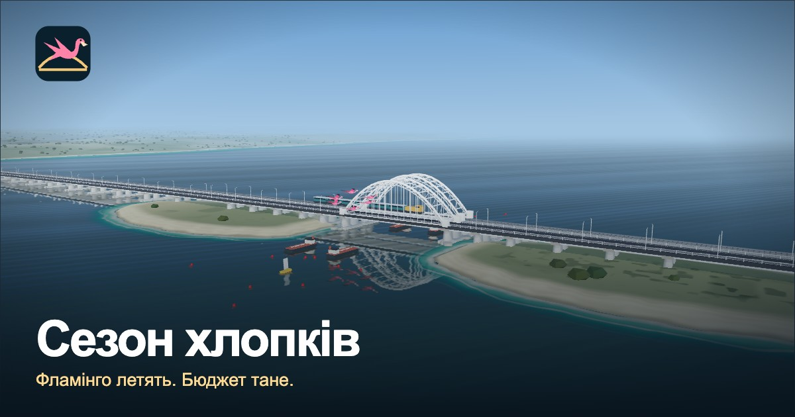

# Сезон хлопків / Pop Season

На першій хвилі у вас є міст, гроші й план. На дев’ятій — міст, фламінго й запитання до того, хто затверджував кошторис.

**[Грати в браузері](https://flamingo-bridge-vhs.rustyperch5.chatgpt.site)** · [English version](https://flamingo-bridge-vhs.rustyperch5.chatgpt.site/en)



Це сатирична 3D tower defense на Three.js. Перед першою хвилею закуповуєш оборону, а далі починається бухгалтерія. Дірку в дорозі можна залатати. Ракети можна докупити. Третє влучання в арку закриває і міст, і фінансовий рік.

## Перша зміна

1. Розгорни стартову оборону й почни облогу. Тягни пальцем або мишею, щоб облетіти арку. Щипок або коліщатко змінюють масштаб.
2. Стеж за мітками на сцені. Натисни на пошкоджену ділянку для ремонту або на установку для поповнення запасу.
3. Увімкни автогру, якщо хочеш подивитися, як із твоїм бюджетом упорається бот. Забрати керування можна в будь-який момент. Це та сама партія.
4. Після поразки залиш псевдонім і порівняй свій результат з іншими на тій самій складності. Якщо керував і бот, біля рекорду буде позначка «Автогра».

Партія зберігається в цьому браузері. Таблиця рекордів спільна. Її можна відкрити посеред хвилі — гра зачекає.

## Запустити локально

Потрібні Node.js 22.12+ та npm. У каталозі репозиторію виконай:

```sh
npm ci
npm run dev
```

Відкрий адресу, яку надрукує Vite. Для перевірки збірки виконай `npm run build`. Локальний сервер Vite запускає гру. Для запису й читання рекордів потрібен ще серверний обробник із D1.

## Де що шукати

| Хочеш змінити | Почни тут |
| --- | --- |
| Правила хвиль, бюджет, автогру або збереження | [main.js](main.js) |
| Камеру, міст або моделі | [scene.js](scene.js), [models.js](models.js) |
| Мобільне меню | [game-menu.js](game-menu.js), [style.css](style.css) |
| Таблицю рекордів | [records.js](records.js), [records-worker.js](records-worker.js), [drizzle/](drizzle/) |

## Гру зібрав за один вечір

За той вечір фламінго навчилися літати, а от зіграти достатньо партій, щоб перевірити баланс, я ще не встиг. Буду радий конструктивній участі всіх, кому гра цікава. Якщо щось зламалося, напиши, на якому пристрої та в якому браузері грав, що натиснув і що побачив. Для камери або мобільного меню кілька секунд відео допоможуть більше за бойове донесення на три сторінки.

Є ідея щодо балансу? Напиши, яку складність обрав, чи вмикав автогру й на якій хвилі стало занадто легко або безнадійно. А якщо вже маєш виправлення — з радістю прийму PR. [Обговорити в Issues](https://github.com/bobjer/flamingo-bridge/issues) · [Відкрити pull request](https://github.com/bobjer/flamingo-bridge/pulls)

© No Sense 2026
