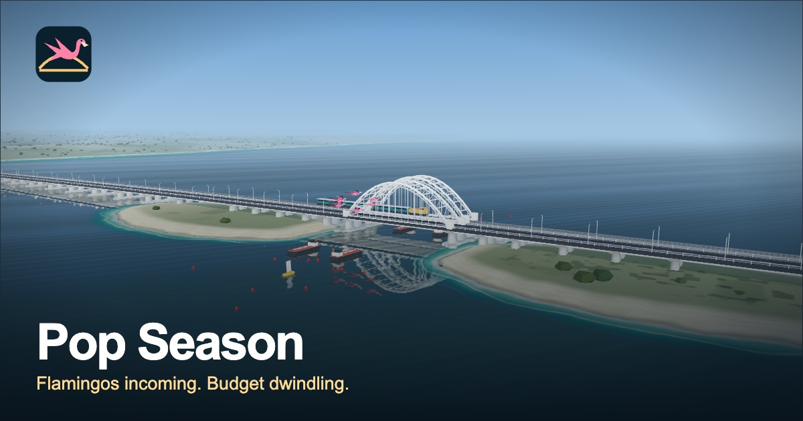

# Pop Season

On wave one, you have a bridge, a budget, and a plan. By wave nine, you have a bridge, a flock of flamingos, and a few questions for whoever approved the budget.

**[Play in English](https://flamingo-bridge-vhs.rustyperch5.chatgpt.site/en)** · [Play in Ukrainian](https://flamingo-bridge-vhs.rustyperch5.chatgpt.site)



Pop Season is a satirical 3D tower defense game. Buy your defenses before the first wave. After that, it’s mostly accounting. You can patch a hole in the road and buy more missiles. The third hit on the arch closes both the bridge and the fiscal year. In true roguelike fashion, no matter how hard you try, Crimea will still end up an island.

> “It’s surrounded on four sides by ocean.” © The greatest PeaceDealer · [Donald Trump on Crimea, POLITICO interview, December 8, 2025](https://www.democrats.senate.gov/newsroom/trump-transcripts/transcript-president-trump-speaks-with-dasha-burns-of-politico-at-the-white-house-12825)

## Your first shift

1. Deploy your starting defenses and begin the siege. Drag to orbit the arch. Pinch or use the mouse wheel to zoom.
2. Watch the markers on the bridge. Select a damaged section to patch it or a launcher to refill it.
3. Switch on autoplay to see what the bot does with your budget. You can take over at any point in the same run.
4. When the arch falls, enter a nickname to compare runs on the same difficulty. Runs that used autoplay get an Autoplay badge.

Your run is saved in this browser. The leaderboard is shared across players. Open it during a wave and the game pauses until you return.

## Run locally

You’ll need Node.js 22.12+ and npm. From the repository root, run:

```sh
npm ci
npm run dev
```

Open the address Vite prints. Run `npm run build` to check the production build. Vite serves the game locally. Reading and submitting scores also requires the leaderboard worker and a D1 database.

## Where to make changes

| To change | Start here |
| --- | --- |
| Waves, budgets, autoplay, or saved games | [main.js](main.js) |
| The camera, bridge, or models | [scene.js](scene.js), [models.js](models.js) |
| The mobile menu or compact desktop layout | [game-menu.js](game-menu.js), [style.css](style.css) |
| The leaderboard | [records.js](records.js), [records-worker.js](records-worker.js), [drizzle/](drizzle/) |

## Feedback and contributions

If a wave felt too easy or hopeless, tell me the wave number, difficulty, and whether autoplay was on. For bugs, include your device, browser, what you did, and what happened. For camera or mobile menu glitches, a few seconds of video beats a three-page field report.

I’d love balance feedback, better 3D unit models, and pull requests with fixes. [Open an issue](https://github.com/bobjer/flamingo-bridge/issues) · [Pull requests](https://github.com/bobjer/flamingo-bridge/pulls)

© No Sense 2026
